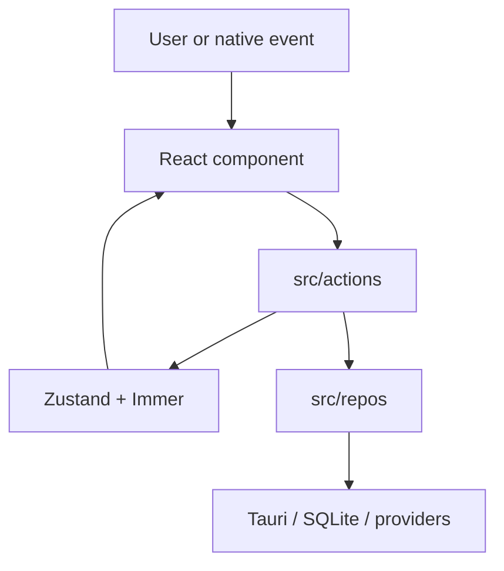

The frontend under `apps/desktop/src/` uses React 19, TypeScript, Vite, MUI/Emotion, React Router 6, Zustand with Immer, RxJS, Zod, and `react-intl`.

Prefer `useAppStore((s) => …)` for reads and named actions for writes. Repos convert at the FFI boundary with `toLocalXxx()` / `fromLocalXxx()`.

`router.tsx` guards Welcome, Login, Onboarding, and Dashboard stages. Dashboard nests Home, Settings, History (`transcriptions`), Dictionary, Styles (`styling`), Chats, and the unfinished Apps placeholder. `components/root/` is more than layout: `DictationSideEffects.tsx` owns much of the event-driven recorder/session bridge, so check it before adding a second global listener.

Use the existing layers:

- `state/` defines slices for app, local profile, settings, transcription history, dictionary, tones/editor, chat/agent, onboarding, login, and updater state.
- `actions/` mutates those slices and coordinates native/database side effects.
- `repos/` wraps database access and chooses AI/storage implementations.
- `sessions/` owns recording-time transcription transports; `sidecars/` manages local native processes.
- `strategies/` contains dictation behavior, and `tools/` implements Assistant tools.
- `utils/` holds normalization, prompt, language, insertion, and recommendation logic.

Provider support is task-specific. Add a provider form, capability, repository dispatch, utility, model/test behavior, and session only where needed; updating an enum alone can expose a choice that falls into an unrelated fallback.

For UI copy, author a meaningful English `defaultMessage`, then run `pnpm --filter desktop i18n`. The `i18n` script extracts/prunes messages and synchronizes catalogs. Avoid embedding untranslated operational errors where a localized user-facing message exists.

Run `pnpm --filter desktop test:unit` for source tests and `pnpm --filter desktop lint` for Prettier/Oxlint. Add tests near pure utilities/repos; use integration tests only when the real provider boundary is the behavior under test.

## Navigation and saved-audio warming

`utils/route-prefetch.ts` owns the dashboard module loaders shared by React Router's `lazy` routes and sidebar intent handlers. `hooks/intent-warmup.hooks.ts` runs the intent timer before warming a hovered or focused surface.

Sidebar destinations wait 400 ms. That is long enough to outlast pointer travel across the rail. Audio warming on a clip's own pill waits 150 ms.

The hook cancels pending timers on leave, blur, route change, and unmount. A failed import does not stay in this loader cache, so a later navigation can call the importer again. The browser still controls its module cache.

Evaluation failures can remain cached. Failed-fetch retries differ between browser versions. Clearing our promise is not a guarantee of recovery without a reload.

Prefetch loads code only. Page effects still run on navigation, not on hover. Do not call a page's mount effects to prefetch data: those effects can update shared state or start operations that belong to a visit. A data-prefetch addition needs an explicit freshness and invalidation contract first.

Saved-audio warming uses the same intent timer and the transcription repository's guarded read. `utils/transcription-audio-cache.ts` deduplicates reads and retains at most four clips with an estimated 32 MiB sample budget. Entries expire after 60 seconds. Speculative warming starts only while fewer than two reads are pending. The cache counts pending reads separately from retained entries. An invalidated read still occupies a slot until it settles because invalidation cannot cancel the native operation. Deletion, updates, purging, and local-data clearing invalidate affected entries. In-flight invalidated reads reject rather than repopulating the cache.

`AudioPlayerPill` claims playback ownership before loading audio. A newer request cancels the previous owner across rows. Unmount, an identity change, disabling the player, and local-data clearing cancel that row's request. The Web Audio helper checks cancellation while preparing the source and releases a context whose resume is interrupted. The player keeps request ownership until preparation settles because teardown can report a stop before startup rejects. The rejection must still reach the error notification. Completed requests release their controller and listeners. Browser-preview audio is synthetic and does not establish native disk or first-audible-output latency.

## Preview harness and figure capture

`apps/preview` is a Vite app on port 5193 that renders the desktop components themselves, through the `@desktop` alias into `apps/desktop/src`. Each entry in `apps/preview/src/lib/registry.ts` records whether the demo is `reused`, meaning the real import, or `recreated`, with `statusNote` naming the store, Tauri, or native-surface dependency that blocked reuse. Start it with `pnpm --filter @maus-inc/preview dev`, run its tests with `pnpm --filter @maus-inc/preview test`, and regenerate the component specs with `pnpm --filter @maus-inc/preview gen:specs`.

The visual guides take every figure from the built desktop app. `apps/docs/scripts/capture-app.mjs` opens the route a figure documents in a WebDriver session (tauri-driver with WebKitWebDriver on Linux), waits for the element the figure is cropped to, closes any onboarding tip card in the way, and screenshots that region at twice the display scale. The session helpers live in `apps/docs/scripts/lib/webdriver.mjs`, and the badge overlay in `apps/docs/scripts/lib/markers.mjs`.

`apps/docs/scripts/figures.mjs` is the list. Each entry names the route, the selector or rectangle to crop, the optional scroll target, and the markers to draw. `apps/docs/scripts/seed-guide-data.mjs` fills the app database with a plausible week of dictation first, so a figure shows real content instead of an empty first run.

A surface the app does not paint in its webview cannot appear in a guide. The pill and its review panel are drawn by the Rust layer, so the guides describe them in prose and show the app settings that control them.

Run `pnpm --filter docs figures` after a change to a surface a guide shows, then `pnpm --filter docs figures:check`. Commit the script change and the regenerated PNGs together so a review can diff them. The marker check is also the docs `lint` script, and it fails when an annotation list and the badges a figure draws disagree.
