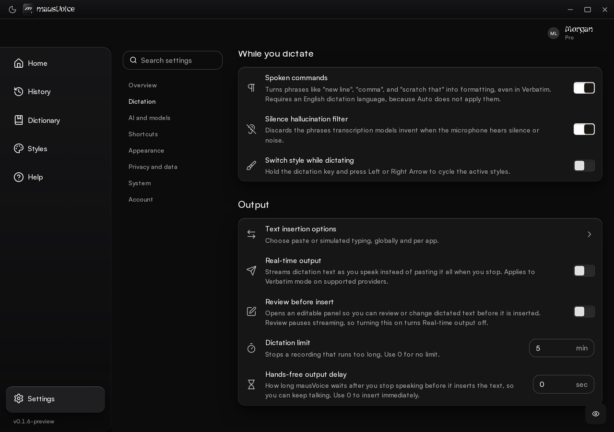
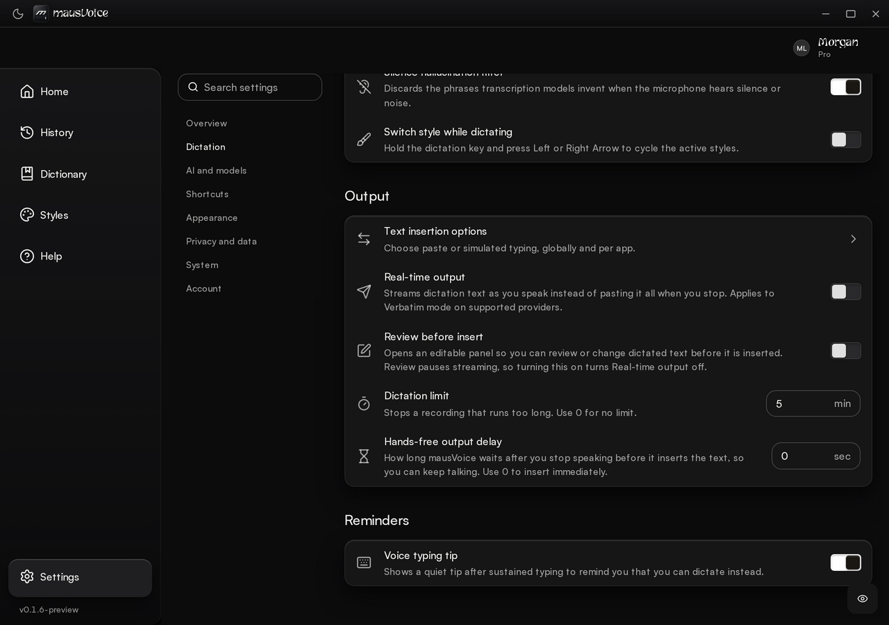
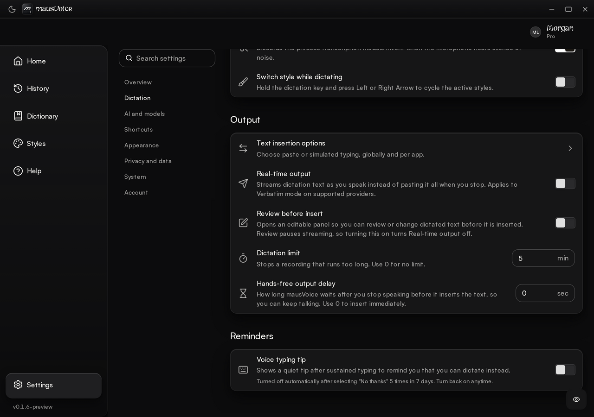
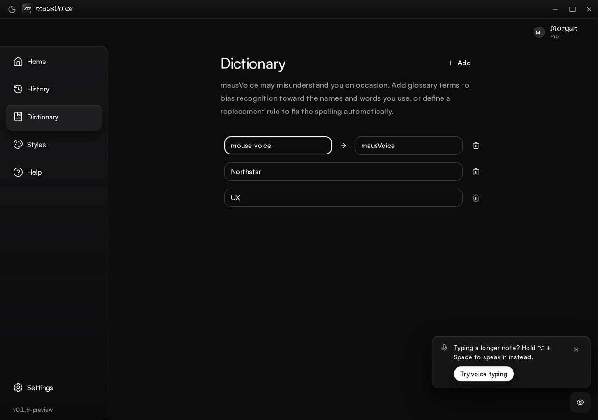

# Sustained typing voice reminder visual verification record (Issue #310)

## Result

Fresh, renderer-matched captures from both the base commit (`5929c44a6c1590aa639b8c23d4ce954f9943698d`) and the updated branch compare the two surfaces this change touches:

1. **Settings > Dictation > Reminders (`Voice typing tip`)**: On the base tree, scrolling the Dictation settings pane to its bottom ends after the **Output** card (`Hands-free output delay`). On the head tree, the **Reminders** card follows **Output** with the **Voice typing tip** toggle row, leading `Keyboard` Lucide glyph, live 1-hour snooze countdown caption when snoozed, and calm auto-disabled explanation when 5 **No thanks** dismissals accumulate within 7 days.
2. **Floating `VoiceTypingTipCard` inside `TipToaster`**: On the base tree, sustained prose typing (>5s across >=8 key transitions) in a focused editable `<input>` produces no prompt. On the head tree, sustained typing surfaces a compact, non-modal card (`340×112.5` CSS px) without stealing focus from the active input, hides **No thanks** for the first 10 seconds, reveals **No thanks** at 10 seconds with zero card geometry shift, switches the primary CTA to **Set up voice typing** when setup is incomplete, and shifts from `bottom-right` to `bottom-left` when a focused editable field occupies the bottom-right corner.

Zero console errors occurred across all 18 captured frames in both dark and light schemes.

## Source and capture method

- **Base tree**: `arena/0.1.6-consolidation` at `5929c44a6c1590aa639b8c23d4ce954f9943698d`, built in a temporary worktree (`/tmp/base-wt`) with `VITE_FLAVOR=preview` and served outside the repository.
- **Head tree**: branch `arena/18f5645e-mausvoice` built with `VITE_FLAVOR=preview` and also exercised live against `pnpm --filter desktop dev:preview` (`http://127.0.0.1:1420`).
- **Browser & harness**: Chromium `153.0.8010.0` unpacked to `/tmp/chr` via `scripts/verify/install-chromium.mjs` and driven over CDP via `scripts/verify/cdp.mjs` from temporary `/tmp/*.mjs` scripts outside the repository. No browser or capture script was added to the working tree.
- **Viewports & media**: `1280×900` (`deviceScaleFactor: 2`, downsampled cleanly to `1280×900` 1:1 CSS viewport PNGs for repository attachment) and `800×600` (minimum Tauri window size), `prefers-reduced-motion: reduce`, both `dark` and `light` color schemes (`mui-mode` + `data-mui-color-scheme` + `prefers-color-scheme`), and `?previewPopup=hidden` on `populated` and `permission-denied` scenarios with route onboarding tips (`[data-tip-card="true"]`) dismissed prior to shutter.

## Attached dark-mode comparison frames

### 1. Settings > Dictation (bottom of pane)

| Base (`5929c44`), `populated`, dark | Head, default enabled, dark |
| --- | --- |
|  |  |

| Head, auto-disabled after 5 "No thanks" dismissals in 7 days, dark |
| --- |
|  |

### 2. Sustained typing floating reminder (`<10s` initial vs `>=10s` delayed "No thanks")

| Head, `<10s` after >5s typing burst (focus stays in input, no "No thanks" yet) | Head, `>=10s` active display ("No thanks" revealed, zero card shift) |
| --- | --- |
|  |  |

## DOM geometry readings and inspected frames not attached

Measured at `1280×900` (`populated` scenario, dark):

| Reading | Base (`5929c44`) | Head |
| --- | --- | --- |
| `Reminders` group present | `false` | `true` |
| `Hands-free output delay` label `x` | `553px` (`h=23.25px`) | `553px` (`h=23.25px`) |
| `Voice typing tip` label box | absent | `x=553, y=787.52, w=612, h=23.25` |
| Narrow `800×600` `scrollWidth === viewportWidth` | `800 === 800` | `800 === 800` |
| Active element during and after tip mount | `<input>` (`true`) | `<input>` (`true`) |
| `[role="status"]` live regions in DOM | `1` | `1` (`Tip: Typing a longer note? Hold ⌥ + Space to speak it instead.`) |
| `VoiceTypingTipCard` box (`<10s`) | absent | `x=924, y=722.73, w=340, h=112.5` (`noThanksVisible=false`) |
| `VoiceTypingTipCard` box (`>=10s`) | absent | `x=924, y=719.50, w=340, h=112.5` (`noThanksVisible=true`) |
| `No thanks` button box (`>=10s`) | absent | `x=1108.09, y=785, w=93.17, h=32` |

Frames captured and inspected in `/tmp/shots-310/` (including 3x crops) but not committed to `docs/assets/` to keep repository binary weight minimal:

- `dictation-settings.base.light.png` (`sha256 2949fdb8...`) and `dictation-settings.head.light.png` (`sha256 4608ab59...`): verified light-surface contrast, hairline border, and identical `x=553` label-column alignment.
- `dictation-settings.snoozed.dark.png` (`sha256 2e42daa4...`) and `dictation-settings.snoozed.light.png` (`sha256 93fd514b...`): verified live caption `Snoozed until 12:14 PM (60 min left).` in both schemes.
- `dictation-settings.auto-disabled.light.png` (`sha256 f22ba267...`): verified unchecked switch and secondary caption legibility on light card background.
- `dictation-settings.narrow-800x600.dark.png` (`sha256 e99cf6ee...`): verified rail collapse into horizontal section tabs and clean multi-line wrapping without horizontal scroll (`800px` scroll width).
- `typing-burst.base.dark.png` (`sha256 f798504b...`) and `typing-burst.base.light.png` (`sha256 408d13bd...`): verified absence of reminder on base after identical 10-key, 5.5s prose burst.
- `typing-burst.head-initial.light.png` (`sha256 0cbd6208...`) and `typing-burst.head-10s-no-thanks.light.png` (`sha256 ac7a26da...`): verified chalk surface, `premiumSurface.light.hover` shadow, dark primary CTA pill, and focus retention in light mode.
- `typing-burst.head-setup-cta.dark.png` (`sha256 422b8176...`): verified rotated copy variant (`Longer reply? ...`) and setup routing round-trip (`shortcutsDialogOpen=true`, `activeRecordingMode=null`).
- `typing-burst.head-bottom-left-dock.dark.png` (`sha256 ef011ca3...`): verified `data-voice-typing-tip-dock="bottom-left"` collision avoidance when a focused `<textarea>` occupies the bottom-right corner.
- `crops/crop-reminders-row.dark.png` and `crops/crop-tip-card-10s.dark.png` (3x magnified crops): verified crisp `1.75` / `1.9` Lucide stroke rendering, unclipped glyphs, optical baseline alignment between **Try voice typing** and **No thanks**, and clean corner joins.

## Code changes driven by pixel and runtime inspection

1. **Browser Preview toolbar overlap (`TipToaster.tsx`)**: Inspecting the first preview frame showed `PreviewToolbar`'s collapsed eye button (`44×44` at `right: 16, bottom: 16, zIndex: tooltip`) sitting directly over the bottom-right corner where floating tips render in `mode === "preview"`. `TipToaster` now offsets `rightStackBottom` to `68px` in `mode === "preview"` while keeping `16px` in production desktop and unit tests, eliminating any overlap without altering `PreviewToolbar`.
2. **Wayland `bridge` and Browser Preview key-stream fallback (`VoiceTypingTipSideEffects.tsx`)**: Inspecting how sustained typing reaches the detector showed that `hotkeyStrategy === "bridge"` (Linux Wayland) and non-Tauri Browser Preview runtimes do not emit per-letter `EVT_KEYS_HELD` updates. `isNativeKeyStreamActive()` now returns `true` only inside a Tauri runtime when `hotkeyStrategy !== "bridge"` and `listenerDeliversKeys(state.keyboardListenerHealth)` holds, so focused-webview `KeyboardEvent.code` fallback works on Wayland and in Browser Preview.

## Stageshow `verify.md` audit and uncaptured surfaces

- **Mode & dials**: Shipped desktop product surfaces follow `Product` mode (`ENERGY 1 / RHYTHM 1 / MOTION 2`); attached verification stills follow `Illustrated` mode (`engineering/design-skills.md`).
- **Rule & `verify.md` walk**: Framing (`R-01`, `R-02`: full window shell, single gutter, zero clipped words or glyphs at 3x), hierarchy (`R-09`..`R-12`: heaviest contrast on primary CTA **Try voice typing**, secondary text button for delayed **No thanks**, real product copy with zero placeholder bars), motion (`R-20`..`R-26`, `R-38`: subtle `6px` `easeOut` enter/exit collapsed to instant fade under `prefers-reduced-motion: reduce`, zero layout jump when **No thanks** fades in at 10s), and polish (`R-16`..`R-19`: Lucide `Mic`, `X`, and `Keyboard` glyphs from the existing icon family, zero em-dashes).
- **Surfaces not captured**: Native macOS Carbon `IsSecureEventInputEnabled()` / Accessibility (`AXSecureTextField`) windows, native Windows UI Automation (`UIA_IsPasswordPropertyId`) windows, and the native macOS/Windows/GTK floating pill window (`showToast` mirror when the main window is hidden). This Linux sandbox has no macOS/Windows host or `tauri-driver` runtime (`engineering/sandbox-coverage-gaps.md`); those paths are covered by the Rust unit suite (`platform::typing_tip::tests`, 5 tests) and frontend Vitest suites (`voice-typing-tip.test.ts`, `VoiceTypingTipSideEffects.test.tsx`).

## Manual verification flow

1. Run `pnpm --filter desktop dev:preview` and open `http://localhost:1420/dashboard/dictionary?previewPopup=hidden`.
2. Focus a text input and type prose continuously for more than 5 seconds (>=8 character/space keys without >1.8s pauses). Confirm the input keeps focus and the compact **Voice typing tip** card appears bottom-right without **No thanks**.
3. Wait 10 seconds without dismissing. Confirm **No thanks** fades in beside **Try voice typing** while focus remains in the input.
4. Click **No thanks**, then open **Settings > Dictation** and scroll to **Reminders > Voice typing tip**. Confirm the live 1-hour snooze caption appears, and toggling the switch off and back on clears the snooze immediately.
