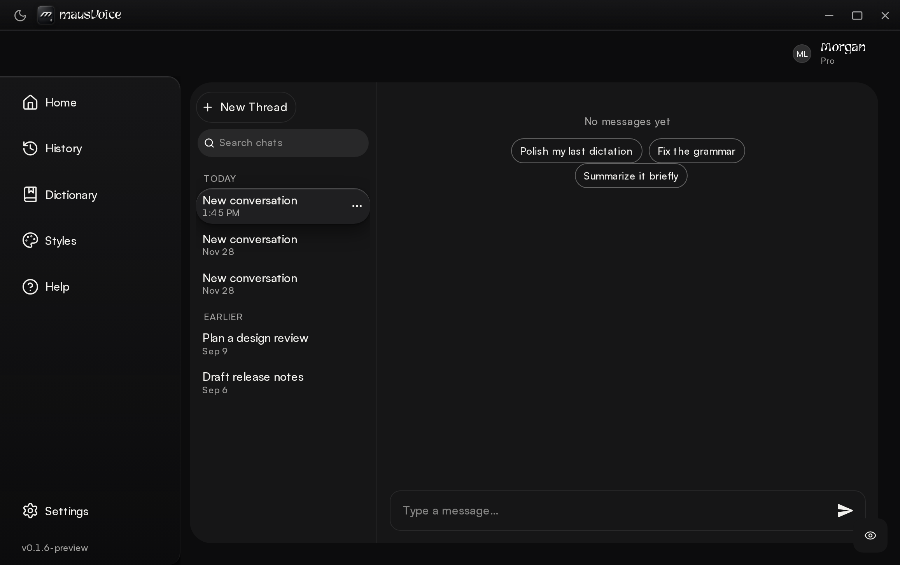
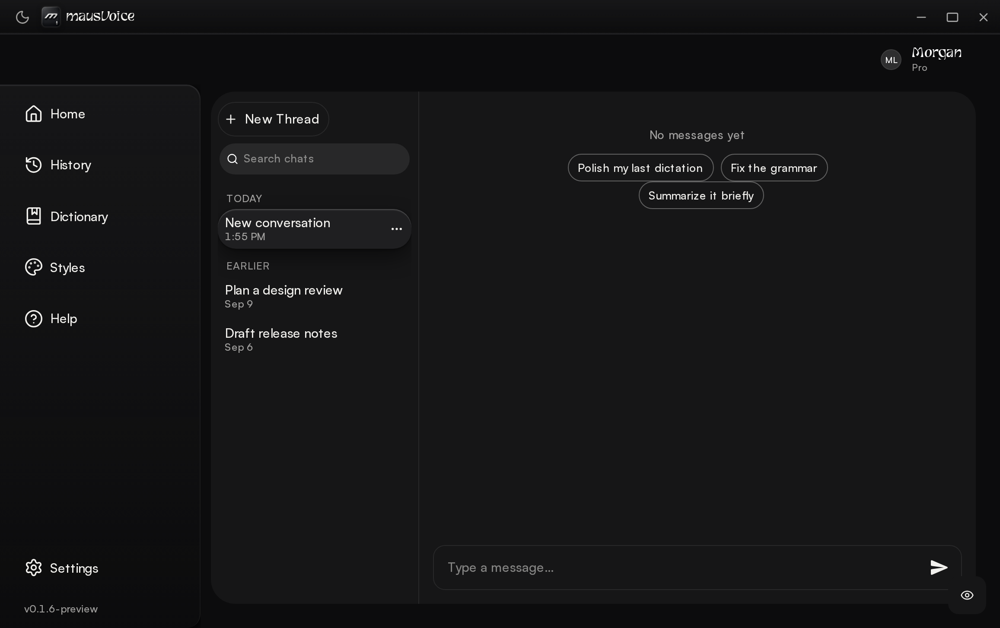
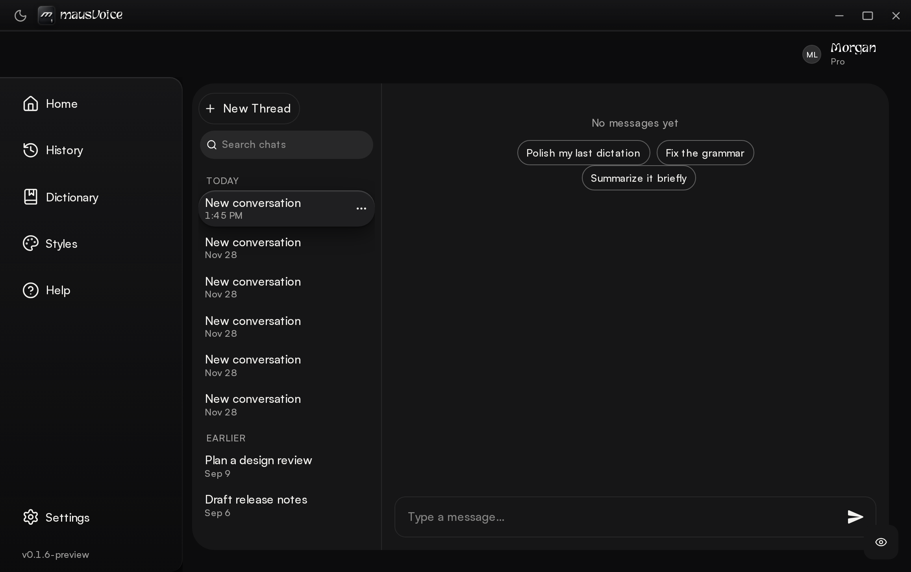
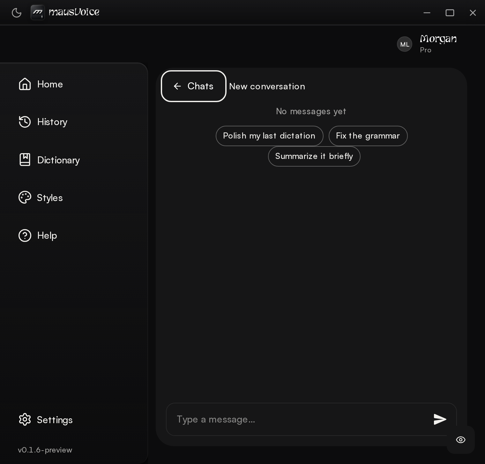

# Chats New Thread empty-conversation retention — visual verification

Issue #352 prevents repeated or rapid clicks on `+ New Thread` from accumulating duplicate empty `"New conversation"` rows in the Chats sidebar while preserving compact-mode navigation back into the thread detail pane and allowing new thread creation once a conversation has messages or has failed/pending writes resolved.

## Capture environment and baseline

- **Baseline commit (`before`)**: `8619b7a8e687e7e829373b35361bdef29e389890` (`arena/0.1.6-consolidation`).
- **Updated workspace (`after`)**: `ChatsPage.tsx` and `chat.actions.ts` fix over `8619b7a8e687e7e829373b35361bdef29e389890`.
- **Target route**: `http://127.0.0.1:1420/dashboard/chats?scenario=chats&previewPopup=hidden` served by `pnpm --filter desktop dev:preview` (browser preview with mocked Tauri runtime, not a native Tauri binary).
- **Renderer and settings**: Headless Chromium `153.0.8010.0` via CDP (`scripts/verify/cdp.mjs`), device scale factor `2`, `prefers-reduced-motion: reduce`, `mui-mode` set per color scheme, and preview tip overlays dismissed before capture.
- **Viewports inspected**: `1157×727` (wide desktop layout) and `760×727` (compact single-pane layout) in both `dark` and `light` color schemes, with zero console errors or uncaught page exceptions.

## Before and after comparison (dark frames)

| Baseline (`8619b7a`) after 3 clicks on `+ New Thread` | Updated code after 3 clicks on `+ New Thread` |
| --- | --- |
|  |  |

- **Sequential clicks (`1157×727`)**: On baseline `8619b7a`, 3 sequential clicks on `+ New Thread` produced 3 stacked `"New conversation"` rows under `TODAY`. With the fix, clicking `+ New Thread` once creates 1 `"New conversation"` row, and clicks 2 and 3 retain the exact same conversation ID (`cda3ee3d-224a-4137-a96f-a924e3041d0b` in dark mode; `fe061b88-b0b6-4455-ad42-d18399e60ed3` in light mode).
- **Rapid simultaneous clicks from a populated thread (`1157×727`)**: Selecting populated `"Draft release notes"` and firing 3 synchronous `click()` calls on `+ New Thread` on baseline `8619b7a` stacked 6 total `"New conversation"` rows (`issue-352-chats-rapid-before-8619b7a-1157x727.dark.png`). With the fix, the 3 rapid clicks coalesce into 1 created `"New conversation"` row (`bafb161a-78f0-475a-bbf1-4431fb369d95`).
- **Send-message transition (`1157×727`)**: Sending `"Draft a quick summary"` in an empty conversation updates its title and persists a message; clicking `+ New Thread` afterwards creates a fresh `"New conversation"` thread.

| Baseline (`8619b7a`) after 3 rapid clicks | Compact (`760×727`) reuse back into detail pane |
| --- | --- |
|  |  |

## Compact mode and layout check

- **Compact navigation (`760×727`)**: Opening the compact thread list (`← Chats`) while an empty conversation is active and clicking `+ New Thread` keeps the active conversation ID unchanged (`compactSameId: true`), creates zero extra rows, and exits the list back to the active empty thread with the `← Chats` button visible and focus restored.
- **Box-fit and overflow audit** (`auditLayout` from `.agents/skills/stageshow/scripts/layout-core.mjs` inside `main` at `prefers-reduced-motion: reduce`):
  - `1157px`: `controls=9`, `paddedContainers=5`, `findings=[]`, horizontal overflow `false`.
  - `760px`: `controls=6`, `paddedContainers=5`, `findings=[]`, horizontal overflow `false`.
- **Light-mode review**: Inspected `wide-initial`, `wide-after-3-clicks`, `wide-after-rapid`, `compact-detail`, `compact-list`, and `compact-reused` frames in light mode; contrast on inverted selected list rows, chips, composer, and focus rings passed with zero console errors. Light-mode PNGs were kept out of git to match repo screenshot conventions (`docs/visual-verification/README.md`).
