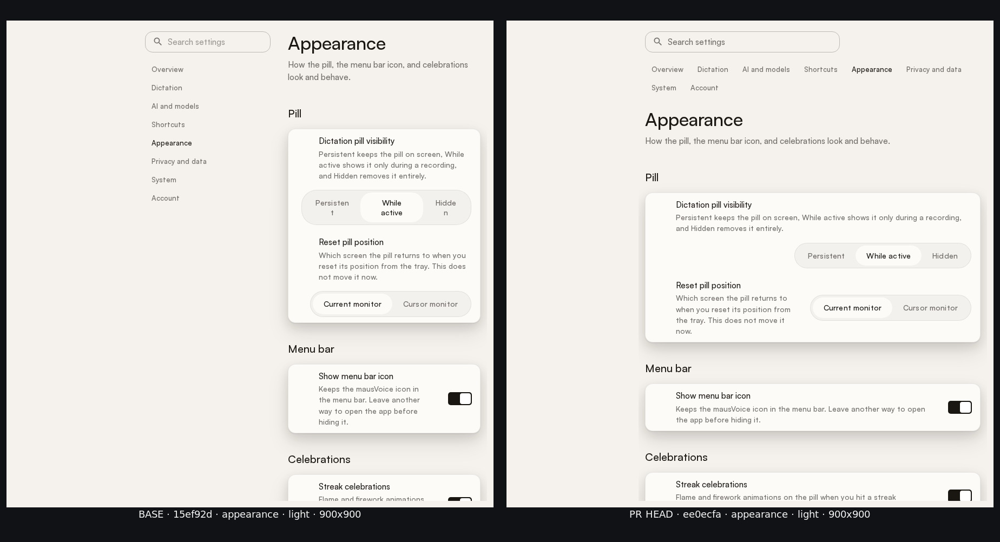
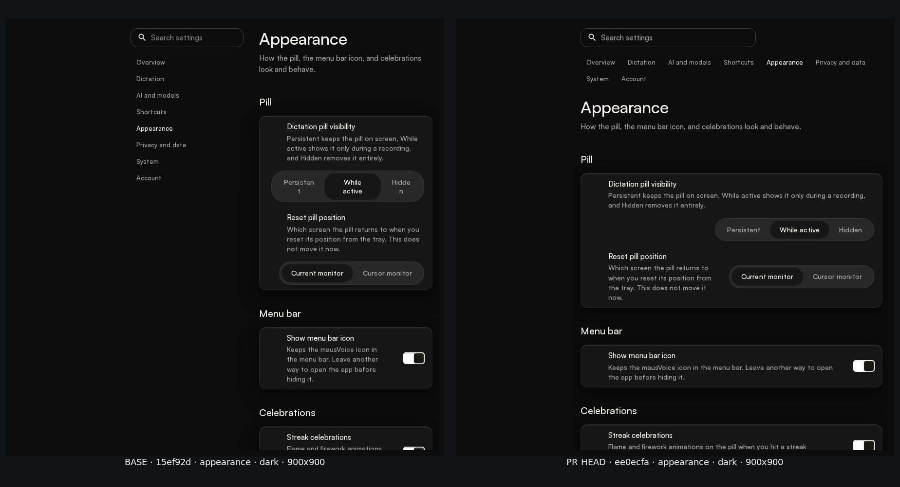
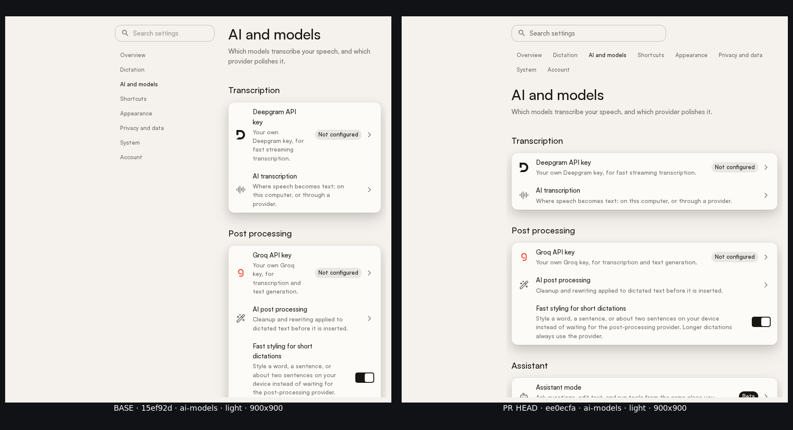
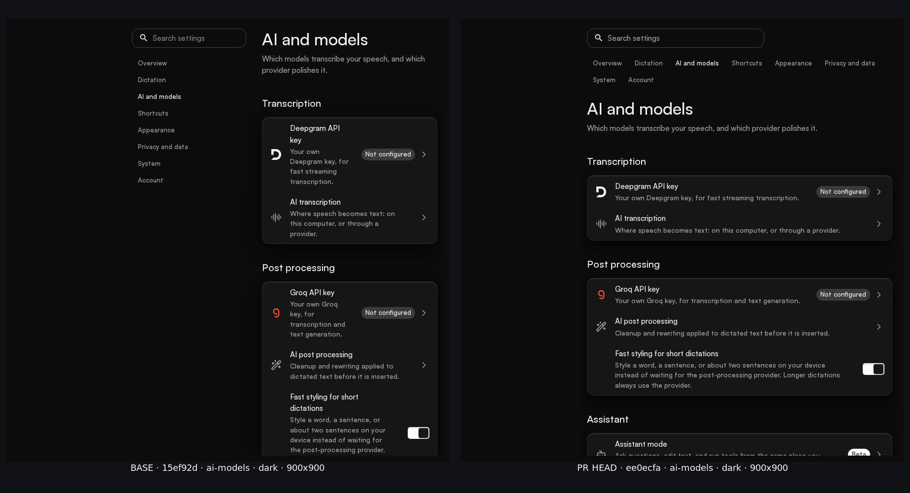
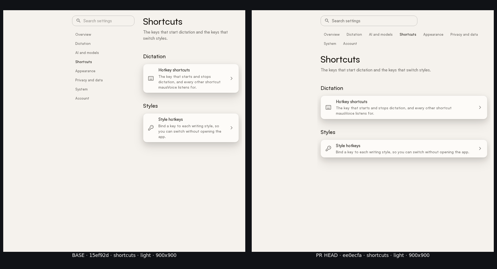
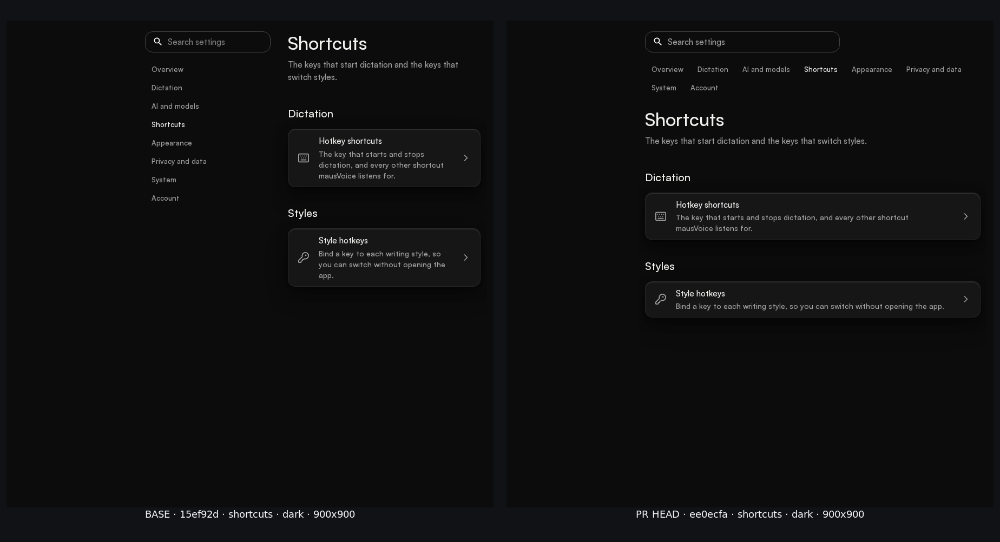

# Issue 368 — Settings layout visual comparison

This comparison uses the exact PR base and the Settings UI source tree that was on the PR immediately before this visual-verification follow-up. This follow-up changes only verification tooling and documentation; it does not change the Settings UI implementation.

- **Base:** `15ef92dc78d997ecccd744c52133ed347119df42`
- **Settings UI source tree:** `ee0ecfa1231db8de0eb2a2c3fdbd85352548e417`
- **Browser:** Headless Chromium `158.0.8127.0`
- **Viewport:** `900 × 900` CSS pixels
- **Themes/routes:** light and dark; Appearance, AI and models, and Shortcuts
- **Harness:** the preview verification harness mounts the production Settings shell and real pages. Only the native Tauri bridge is faked; the pages use the harness's documented default/empty user state.

The 900px window is the reported range where the Settings content width falls below the 680px container threshold. At the base, the shell keeps a vertical rail beside the page. At the PR head, search and wrapped navigation move above the page content. In the Appearance captures, the **Reset pill position** control is visible with both monitor choices; the AI and models and Shortcuts captures provide different content and control shapes so the review is not limited to switch-only pages.

| Page | Light comparison | Dark comparison |
| --- | --- | --- |
| Appearance — includes Reset pill position |  |  |
| AI and models |  |  |
| Shortcuts |  |  |

## Findings

- Before/after captures used the same real browser build, viewport, theme, harness, and seeded state.
- All six runs passed the layout capture checks: correct page heading, Satoshi loaded, MUI spacing token was `8px`, no geometry problems, no browser console errors, and no failed requests.
- At 900px, the measured page heading moves from `x=520` in the base rail layout to `x=256` in the compact wrapped-navigation layout; page content width grows from `356px` to `620px`. The expanded usable column is visible on all three pages.
- The Appearance screenshot visibly includes **Reset pill position**, its explanatory copy, and the Current monitor / Cursor monitor choices.
- No horizontal document overflow was detected at this viewport. The harness is not a native Tauri launch and the captures do not claim native-shell behavior.

For repeatable comparison steps and broader matrix guidance, see [`engineering/ui-verification/README.md`](../../../engineering/ui-verification/README.md).
