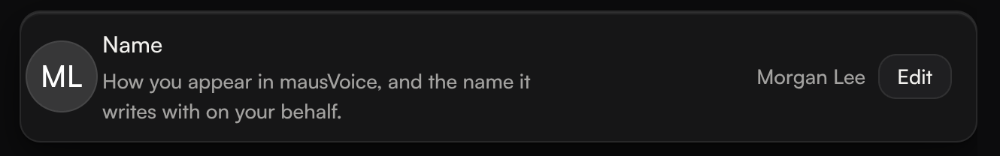
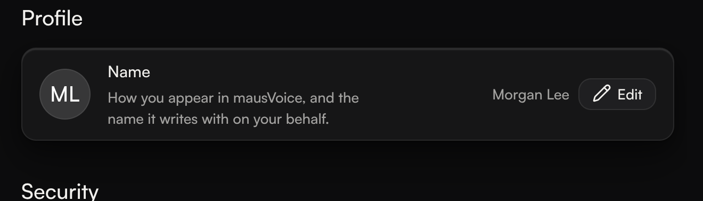

# Settings row icon language — visual verification

Issue #369 gives the desktop settings surface one icon language: every row leads
with a lucide glyph at `settingGlyphProps` (22px, stroke 1.9) in a fixed lane, and
the search field takes the same stroke at 16px through `settingSearchGlyphProps`.
This report records what the rendered surface showed in the browser preview and
what was measured from the DOM. It closes the visual pass #369 asked for.

## What was captured

The desktop browser preview (`pnpm --filter desktop dev:preview`) serves the
production route tree over a mocked Tauri runtime. Every settings page was opened
at `/dashboard/settings/<page>?scenario=populated&previewPopup=hidden`, in the
`light` and `dark` color schemes, at 1157×727 CSS pixels with reduced motion
emulated. The component catalogue (`apps/preview`) was opened at
`#/c/settings-row` in both schemes. The preview toolbar was hidden through the
preview's own `previewPopup` parameter, and the in-app provider tip was dismissed
with its own control before each capture so no popup covered a row.

Images live in `docs/assets/`:

Attached to the pull request, and committed here as the pairs:

| File | Surface |
| --- | --- |
| `settings-icons-compare/dictation.dark.png` | The three switch rows that had no mark, plus the descriptor rows beside them |
| `settings-icons-compare/privacy-data.dark.png` | Four of five rows gaining a mark |
| `settings-icons-compare/system.dark.png` | Startup and update switches |
| `settings-icons-compare/appearance.dark.png` | A page where no row had a mark |
| `settings-icons-account-row-before.dark.png`, `-after.dark.png` | The identity row, where the lane itself was wrong |

Looked at but deliberately not committed, because the description keeps to the dark frames
and a full sweep is a pull-request attachment rather than a repository commit: the light
frames for the same four pages, and the 1280, 1100 and 800 captures behind the geometry
table. `scripts/verify/shot-settings.mjs` regenerates all of them.

## Measurements

Glyphs were found from the rendered DOM rather than by eye: every `svg` whose
measured box was 22px was recorded with its centre, stroke width, lucide class
and `aria-hidden` attribute. Results across all eight settings pages, in both
schemes (`home`, `dictation`, `ai-models`, `shortcuts`, `appearance`,
`privacy-data`, `system`, `account`):

- Every settings-lane glyph measures **22×22**. No other size appears in the lane.
- Every settings-lane glyph carries **stroke-width 1.9** (read from the `lucide-*`
  classes: `lucide-audio-lines`, `lucide-wand-sparkles`, `lucide-zap`,
  `lucide-bot`, `lucide-power`, `lucide-keyboard`, `lucide-circle-arrow-up`,
  `lucide-bell-ring`, and the rest).
- The lane centre is one value per page and identical across pages: **x = 536**
  at 1157px, and still x = 536 with the window narrowed to 900px.
- Every glyph is `aria-hidden="true"`, so no leading mark is part of a row name.
- **No horizontal overflow** on any page in either scheme, at 1157px or 900px.
- The search field's glyph measures **16×16, stroke 1.9, `lucide-search`,
  `aria-hidden="true"`**.

Two entries a naive sweep would flag are correct and belong to their documented
exceptions: the app sidebar's navigation glyphs (32px, stroke 1.85, centre x = 39)
are shell chrome, not settings rows; and the provider marks on `ai-models` are
`ProviderLogo` images, which carry no `stroke-width`, placed in the same 22px box
so the titles beside them land on the same edge as glyph rows.

## Stageshow gate

Mode: illustrated, because these files are captures of the product (`docs/assets/*.png`,
`docs/visual-verification/**`). Read for this pass: `SKILL.md` (The one idea and the five
failures), `references/verify.md` in full, and the mode split in
`engineering/design-skills.md` (`Stageshow on every UI touch`, including the sandbox
notes that kept this gate a stated hypothesis until now).

Stageshow's `film.mjs --gate` judges a `.ss-stage` composition, which these are not: they
are the real product, so `layout.mjs` is the matching check. It reports box fit and
authored insets for ordinary host controls outside a Stage. Run on the production
preview build at 1157×1000, against `main`, on all eight pages, in both schemes:

```
light home         : 8 controls, 0 padded containers  → no-issues-detected
light dictation    : 3 controls, 7 padded containers  → no-issues-detected
light ai-models    : 5 controls, 4 padded containers  → no-issues-detected
light shortcuts    : 2 controls, 0 padded containers  → no-issues-detected
light appearance   : 5 controls, 8 padded containers  → no-issues-detected
light privacy-data : 1 control, 12 padded containers  → no-issues-detected
light system       : 5 controls, 8 padded containers  → no-issues-detected
light account      : 4 controls, 0 padded containers  → no-issues-detected
dark  (same eight) : identical coverage, every page → no-issues-detected
```

What that does not cover, and what was checked by eye instead, is the part the script
says it defers: optical centring, shape contours, interaction states and motion. The
You see / You do lines this surface would print, walked against the frames above:

- `fat row` — no. Rows sit at their own pitch; the description wraps to two lines only
  where the text needs it, and the row grows with it.
- `loose list` — no. Pitch is even within a card and across pages.
- `empty pane` — no. No void under a list on any of the eight pages.
- `mixed icons`, `clipped glyph`, `emoji icon`, `invented mark` — none. One family, one
  size, one stroke, measured above, and the marks are lucide's own drawing.
- `unit wrapped` / centred-amount — not applicable; no figures in this lane.

The one composition fault the skill names first, a whole window floating with even
margins, is not what a screenshot of a running app is meant to be, and these are
in-window frames rather than figures on a page. The card at the top of this report is a
crop of the product's own pane, not a plate under a mockup.

## Dialogs behind the rows

The row is only half the pane. A review of this change pointed out that the
settings dialogs still imported Material icons, so the rule held on the list and
broke the moment a row was opened. Every Material import under
`components/settings/` is now gone (24 glyphs across 11 files, each mapped to its
lucide equivalent at the size it had), and the audit that keeps it that way reads
the whole folder, not just the files that render rows.

Driven in the preview, both schemes, opening each dialog from its row:

| Dialog | Authored glyphs | Material |
| --- | --- | --- |
| `Deepgram API key` | 0 | 0 |
| `Groq API key` | 0 | 0 |
| `Microphone settings` | 1 | 0 authored (1 library) |
| `Audio` | 0 | 0 |
| `Dictation language` | 2 | 0 authored (1 library) |
| `Diagnostics` | 2 lucide | 0 |
| `Edit profile` | 3 lucide | 0 |

"Library" is MUI's own `Select` arrow, which the theme draws once for every
dropdown in the app. It is not an authored icon and the design document now says
so, rather than leaving a reader to wonder why one Material shape survives
inside a page the rule covers.

## States checked

- **Hover**: the row takes `background-color` `rgba(0, 0, 0, 0.04)` on the level1
  face; the glyph colour does not shift, so the mark stays quiet while the row
  answers.
- **Focus-visible**: a 2px outline in `text.primary` (`rgb(26, 23, 18)` in light)
  at offset −2, on the row itself, not on the glyph. Reached by keyboard, the row
  is the focused element.
- **Danger**: `iconTone="danger"` rows on `account` take `error.main` on the glyph
  while the title keeps `text.primary`; checked in both schemes.
- **Avatar lane, corrected after review**: the 48px avatar no longer overhangs a fixed
  22px lane. Seen in the account frame, the overhang read as a crammed row, so the lane
  became a `minWidth` and the avatar now gets a lane of its own. Measured before and
  after on the account page at 1157×727: the avatar's left edge was 3px from the card
  edge and 3px from its title; it is 16px and 16px now, and its lane measures 48px while
  every glyph lane still measures 22px. The Name title moved from x=563 to x=589; the
  other three rows on the page keep x=563. See the pair below.
- **Action pill**: the Edit pill carries an 18px pencil, the size the app's own buttons
  give `startIcon`, because the verb and the glyph read faster together than either
  alone. Verb-only pills elsewhere keep no mark.

## What these captures are not

They are browser-preview captures driven by the mocked Tauri runtime, not
screenshots of a native Tauri window. GTK, AppKit and Win32 chrome, window
controls and native scrollbars are outside them. Fonts fall back to the system
stack where Satoshi is unavailable in the capture browser, so letterforms differ
slightly from a packaged build while the glyph lane, spacing and alignment do not
depend on them.

The one-off browser used `@sparticuz/chromium` with Puppeteer Core for the captures and
with `playwright-core` for the `layout.mjs` runs, all outside the repository; no
browser, automation package or test harness was added to it. The sandbox has no Debian
mirror access, so the two shared libraries that build needs (`libnspr4`, `libnss3`) were
compiled from NSS and NSPR sources fetched from GitHub and linked from `/tmp` for the
capture process only. The gate scripts were run from a `/tmp` copy, as the execution
limits in `docs/decisions/stageshow-on-every-ui-touch.md` require.

## Account profile row, before and after

The row as it shipped (left) and at the head commit (right), both dark, captured from
the same build at 1157×727 with device scale 2 and motion reduced. The before frame is
produced by restoring the old lane rules in the capture browser only, so the two frames
differ in nothing but this change.

| Before | After |
| --- | --- |
|  |  |

What changed, and what the frames show:

- The avatar sits 16px from the card edge instead of 3px.
- The avatar sits 16px from its title instead of 3px.
- The Edit pill gained its pencil; its width grew 73.4px to hold a 30px-tall pill with an
  18px mark and a 6px gap.
- The Name title started 26px further right than the Sign out title below it. That is
  the cost of a 48px mark against a 22px one, and it is the trade this lane makes: a
  shared title edge with a 48px picture inside it would need the picture to overlap its
  own row's text.

The light scheme was captured for both frames and inspected at the same scale. It reads
the same way: the gutters are symmetric, the pencil is legible at `text.primary` in the
pill, and the avatar ring separates from the card at the same weight as in dark. No light
frame is attached, because the change is not about light.

**Sharing a higher lane was measured and set aside.** Rendering the Sign out row's lane at
40px raises the whole page's title edge and drops the avatar to 40px, stepping all four
titles to x=589. It removes the step entirely, but it moves three rows of a shipped page
and shrinks the picture for a spacing-only gain, so it is a human call rather than one
this change should make silently.

## After the base moved: the merge pass

The base branch moved from `12b0b09` to `6feba41` mid-review, and its settings
work (#363, #383) rebuilt the same row from the other direction: a leading slot shared
by every row, a trailing glyph column, and an action pill that takes a radius. The
merge kept both ends and the capture was rerun against the merged tree, because a
chassis that moves is exactly the thing a diff cannot show.

Method: `scripts/verify/shot-settings.mjs` from the base's own harness, pointed at
`CHROMIUM_PATH` and `LD_LIBRARY_PATH` for a browser kept outside the repository, at
all three supported widths, both themes. It exits nonzero on a layout failure or a
console error, and both runs reported `PROBLEMS: []` and `CONSOLE_ERRORS: []`. The
dialog round trip and the account row were captured separately through the mocked
Tauri runtime on port 1420.

What the pixels showed, and what changed because of them:

- **The Edit pill drew two pencils.** The merge kept the base's pill and folded this
  branch's `action.icon` into it, and the resolution left the icon line twice, one
  copy per side. No test asserted the pill's contents, so the merge was green. The
  frame showed it immediately. The duplicate is gone and
  `setting-row-icons.test.tsx` now counts the pill's marks; reverting the fix fails it.
- **Every row on a page shares one title column.** Twelve rows on the dictation page
  measured title `x=577` and slot `24`. Before the merge the switch rows had no lane
  at all, which was #369's own defect.
- **The avatar keeps its 48px lane.** The frame reads 16px to the card edge and 16px
  to the title, and the Name title sits 26px right of the row below it. That step is
  the documented cost of a 48px mark in a 22px language, not a regression.
- **The rail clipping at 800px** (`Privac`, `nodels`) is in the base's own committed
  before/after pair under `reports/ui-verify/settings-compare/`, so it predates this
  change and is not touched here.
- The dialog opens over the dimmed page, Escape closes it, and the four title columns
  measure identically before and after the round trip in both themes.

Light was captured and inspected at the same widths. The gutters, the pill's pencil
and the column edges read the same as in dark; no light frame is attached, because the
change is not about light.

## A tall row separates the mark from its title

The base's `VoquillMigrationSettingsSection` arrived in the second base bump. It is a
`SettingRow` whose body is a whole panel: status chips, two alerts and a counts line, 364px
tall in the `voquill-migration` scenario. §369's rule gives it a glyph, and the lane
centres a mark vertically on its row, so the glyph sits at y=170.8 while its title starts
at y=10 — 160px from the words it names, against 11px on every other row.

Measured, dark and light, at 1157×727:

| Row | Height | Lane top | First text top |
| --- | --- | --- | --- |
| `incognito_mode` | 65.5 | 21.8 | 10 |
| `preserve_audio_on_failure` | 85.8 | 31.9 | 10 |
| `voquill_migration` | 363.7 | 170.8 | 10 |

Two answers, and they are not equivalent:

- **Centre every mark on its row**, which is shipped behaviour and what makes the 48px
  identity avatar sit right against a two-line label. It breaks only this one row.
- **Pin every mark to its title's first line.** It fixes this row with one exception-free
  rule. It moves the mark up about 11px on every ordinary row and pulls the 48px avatar
  off the centre of its label, so it re-decides a look that is already shipped.

This is a human call, not one this change should make silently, so the frames are attached
and the behaviour is left as it was. The row still leads with a glyph in the shared lane,
which is the #369 requirement; only its vertical position inside a 364px panel is open.

## Before and after, from two real trees

Earlier passes compared against frames made by restoring old CSS inside one browser. That
is weaker than a real pair, so this pass builds both trees: `a8e11e5` checked out with
`git worktree add /tmp/base-wt a8e11e5`, its catalogue served on 5293, this branch's on
5193, the same harness URL, the same scenario, the same 1280×900 viewport and the same
`deviceScaleFactor`. Nothing about the capture differs between a pair except the code.

| Page | Rows | Rows leading with a mark, base | … this head |
| --- | --- | --- | --- |
| Appearance | 4 | 0 | 4 |
| Privacy and data | 5 | 1 | 5 |
| System | 7 | 3 | 7 |
| Dictation | 8 | 5 | 8 |

The pairs are committed under `docs/assets/settings-icons-compare/` as
`<page>.dark.png`, before on the left, after on the right.

Two corrections this pass forced, both of which earlier text had wrong:

- **The base did not misalign its titles.** It already reserved the empty leading slot,
  so a row without a mark started its words on the same column as a row with one —
  measured at x=577 for all seven System rows in both trees. The 4× crops of the single
  `start_on_system_startup` row show it: same edge before and after, and the difference is
  that the reserved slot is now filled. The change is additive. A first reading of the
  full frame said the titles stepped; the crop and the measurement say they do not, and
  they win.
- **The gap was the switch rows.** On Dictation the three text-only rows were
  `Spoken commands`, `Silence hallucination filter` and `Switch style while dictating`;
  on Privacy and data the four were every switch row plus `Preserve audio on failure`.
  That is the shape #369 names, and it is what the pairs show being closed.

A DOM probe run during this pass reported `glyph: true` for base rows. It was matching the
trailing chevron, not a leading mark, which is exactly the kind of reading that makes a
green check lie. Counting leading marks and looking at the crop is what settled it.
