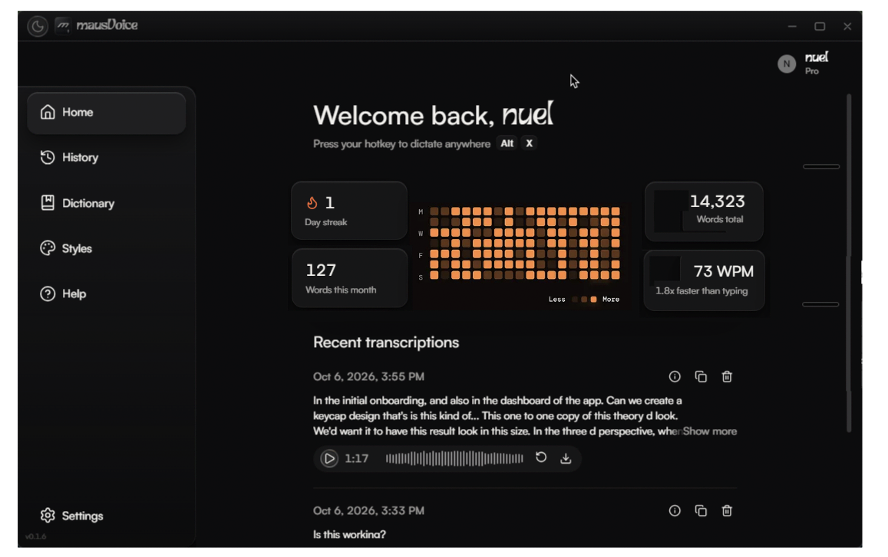
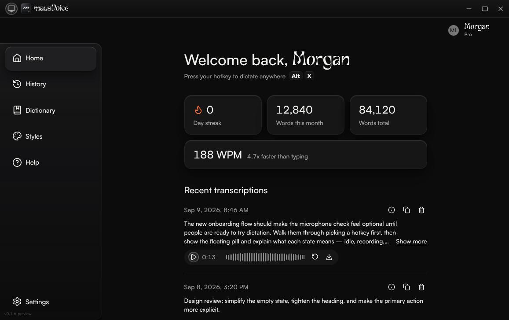
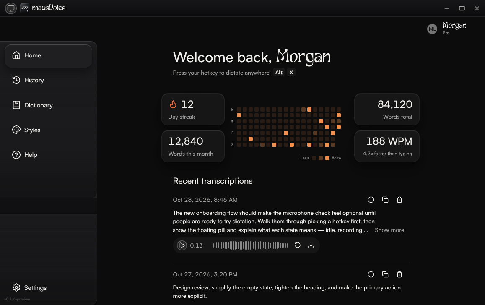

# Home metric grid visual verification record

## Result

Fresh screenshots are included for the live base and the updated PR code. They show the old Home cards on the base and the compact metric pairing on the updated head. The reference-sized updated capture keeps the heatmap between the two metric columns and shows the requested `Alt` and `X` keycaps.

The responsive captures cover 768×1000, 390×1000, and 320×1000 CSS-pixel viewports. The updated Home frame measured 464px, 342px, and 272px at those widths; it measured 620px at 1157×727. At every captured viewport, the document width matched the viewport width. Separate screenshots force the frame itself to 559px and 560px. The compact layout appears at 559px, and the wide layout appears at 560px. The empty-scenario capture confirms the compact layout with no speed sample.

These are browser-preview captures, not screenshots of a native Tauri window. They cover the dark appearance used by the design reference; they do not claim a light-mode review.

## Source and capture method

- The live base before the change was `arena/0.1.6-consolidation` at `609f2a8724343bbbdbc7f980174d2dcbdbcadb2e`. This snapshot still uses the legacy Home statistics cards and does not contain `HomeAnalyticsGrid`.
- The updated code after the change was PR head `e6105912e5d6c086b747b035fe77695f18212007`. The screenshot-and-documentation commit that follows it does not change application code.
- The base and head previews were served from separate source snapshots. Both used the `populated` route, but the snapshots contain different preview fixture dates and streak values. The screenshots compare layout, not controlled metric values. The old `pr-293-home-*.png` files were not used as base or updated-head evidence.
- The capture used one-off Chromium 153.0.8010.0 from `@sparticuz/chromium` 153.0.0 with Puppeteer Core 25.16.0. The temporary browser ran outside the repository, as explicitly authorized for these screenshots. No browser, automation package, or test harness was added to the repository.
- Browser viewport sizes are CSS pixels at device scale factor 1. Dark color-scheme and reduced-motion preferences were emulated. The preview itself remained in its `system` theme mode, and the preview-only toolbar was hidden in the captured images.
- The reference shows the literal `Alt` keycap, while the browser preview's temporary OS adapter defaults to macOS and renders `⌥`. For these captures only, the preview OS adapter was temporarily set to Windows, then restored; no production code or lasting preview code change was committed.
- `PreviewRoot` does not mount `KeyPressSideEffects`, so the shortcut recorder opens but does not accept browser keypresses. Rather than alter the keycap text or claim the UI recorded it, the preview's exported `produceAppState` helper set the fixture's dictate hotkey to `Alt` + `KeyX`. The visible badge was checked as `Alt + X`. This was capture-only preview state, not persisted product data.
- The live base displayed its one-time release announcement. It was dismissed by selecting **Next** twice, then **Got it!**. The **Getting started** checklist was skipped before capture. The base render also logged a missing-key React warning in its Home translation content; the route rendered and the warning did not obscure the screenshots.

## Reference-sized comparison

The requested design reference is `docs/assets/image_253.png` and measures 1157×727. It is a reference, not an app capture.



| Live base, `609f2a8` | Updated code, `e610591` |
| --- | --- |
|  |  |

The updated image has a 620px Home frame. Its wide grid areas are `"streak activity total" "month activity speed"`. The base image shows the actual older card layout from the live base, not a reconstructed or historical "before".

## Responsive and edge-case screenshots

The file names identify the source commit and viewport. The 559px and 560px images use a 1157×727 browser viewport while setting the **Home frame** to the named width; these are not 559px and 560px browser viewports.

| Check | Live base | Updated code |
| --- | --- | --- |
| 768×1000 viewport | [Base PNG](../assets/pr-293-home-base-609f2a8-768x1000.png) | [Updated PNG](../assets/pr-293-home-head-e610591-768x1000.png) |
| 390×1000 viewport | [Base PNG](../assets/pr-293-home-base-609f2a8-390x1000.png) | [Updated PNG](../assets/pr-293-home-head-e610591-390x1000.png) |
| 320×1000 viewport | [Base PNG](../assets/pr-293-home-base-609f2a8-320x1000.png) | [Updated PNG](../assets/pr-293-home-head-e610591-320x1000.png) |
| Updated frame at 559px | Not applicable to legacy layout | [Compact layout PNG](../assets/pr-293-home-head-e610591-frame-559px.png) |
| Updated frame at 560px | Not applicable to legacy layout | [Wide layout PNG](../assets/pr-293-home-head-e610591-frame-560px.png) |
| Updated empty scenario, 390×1000 | Not applicable to legacy layout | [No-speed PNG](../assets/pr-293-home-head-e610591-empty-390x1000.png) |

The `empty` preview scenario has no transcription rows and no speed sample. Its fixture still seeds account totals, so nonzero streak or word totals are expected.

The measured updated frame widths and grid areas were:

| Capture | Frame width | Grid areas |
| --- | ---: | --- |
| 1157×727 viewport | 620px | `"streak activity total" "month activity speed"` |
| 768×1000 viewport | 464px | `"streak total" "month speed" "activity activity"` |
| 390×1000 viewport | 342px | `"streak total" "month speed" "activity activity"` |
| 320×1000 viewport | 272px | `"streak total" "month speed" "activity activity"` |
| 1157×727 viewport, frame forced to 559px | 559px | `"streak total" "month speed" "activity activity"` |
| 1157×727 viewport, frame forced to 560px | 560px | `"streak activity total" "month activity speed"` |
| Empty scenario, 390×1000 viewport | 342px | `"streak total" "month ." "activity activity"` |

At 560px and wider, the speed-less wide map remains `"streak activity total" "month activity total"`; the total card occupies the named area across both rows. In the compact no-speed map, the second row has month on the left and an empty right cell, with the heatmap below.

## Manual visual-check flow

A person can inspect the linked PNGs above without running the app:

1. Compare the reference image with the two 1157×727 captures. Check the location of the heatmap, the card pairings, and the visible `Alt` and `X` keycaps.
2. Open each base/head pair at 768×1000, 390×1000, and 320×1000. Check that labels remain legible and the page does not require horizontal scrolling.
3. Compare the 559px and 560px frame captures. The 559px frame uses the compact map; the 560px frame uses the wide map. The browser viewport stays the same in both images, so the change is tied to the measured frame width.
4. Open the empty-scenario capture. Confirm that no speed card is shown, the total metric remains beside streak, the month row leaves its right cell empty, and the heatmap remains below.

For a separate check in the attached browser preview, select **populated** or **empty** in its scenario toolbar and reset the scenario. Measure the frame and grid with DevTools rather than inferring the container state from the browser width:

```js
(() => {
  const frame = document.querySelector('[data-testid="home-page-frame"]');
  const grid = document.querySelector('[data-testid="home-analytics-grid"]');
  return {
    frameWidth: frame && Math.round(frame.getBoundingClientRect().width),
    viewportWidth: window.innerWidth,
    documentScrollWidth: document.documentElement.scrollWidth,
    gridAreas: grid && getComputedStyle(grid).gridTemplateAreas,
  };
})()
```

The browser-preview shortcut recorder is not wired to key events, so it cannot set `Alt+X` through the UI. The screenshot captures used the exported store helper described above; the screenshot does not claim otherwise. To test the boundary in the preview, use a viewport with enough room, temporarily set `home-page-frame` to `width: 559px; max-width: none`, record the grid areas, then change it to `560px` and compare. Remove the temporary inline styles afterward.

## Historical renders

`pr-293-home-mobile-after.png`, `pr-293-home-tablet-768-after.png`, and the other existing `pr-293-home-*.png` files are retained as historical PR artifacts. They are not captures from the live base or the updated head listed above, and they are not used as evidence in this record.

## Design guidance consulted

- [Carbon Design System dashboard guidance](https://carbondesignsystem.com/building-blocks/data-visualization/dashboards/) recommends consistent layout, clear hierarchy, and grouping related metrics.
- [Android Developers adaptive Material guidance](https://developer.android.com/codelabs/adaptive-material-guidance) recommends adapting to available window size and grouping related content.
- [W3C WCAG 2.2 reflow guidance](https://www.w3.org/WAI/WCAG22/Understanding/reflow.html) supports narrow-width checks for two-dimensional scrolling at 320 CSS pixels.
