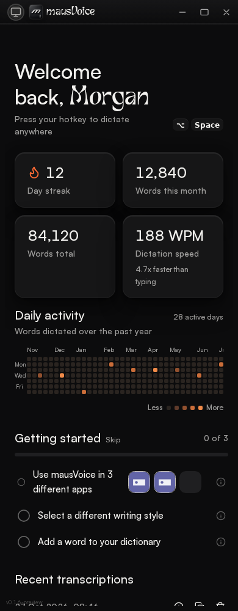
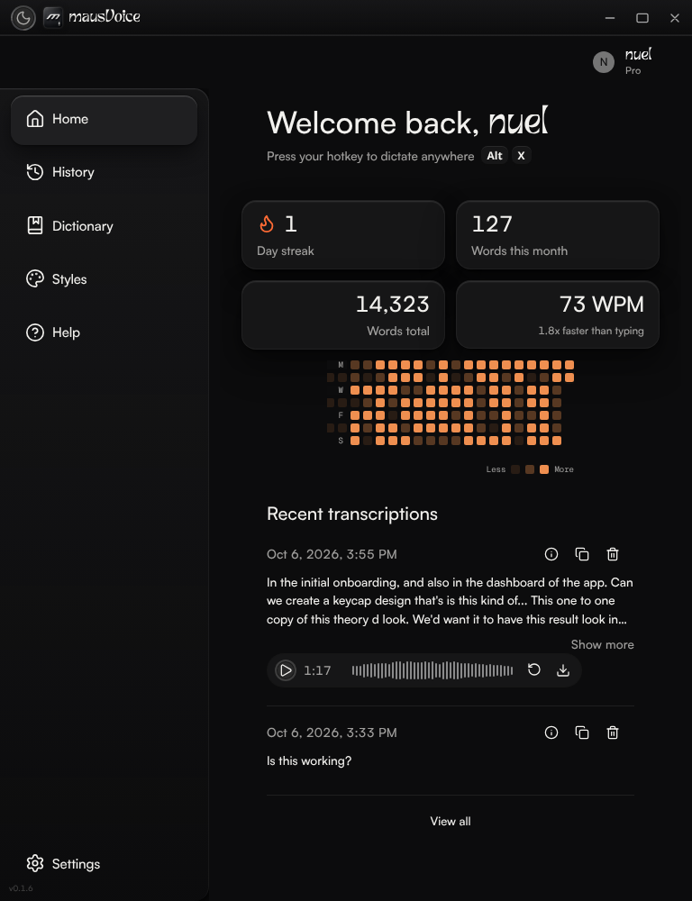

# Home metric grid: manual visual verification record

## Status

The compact-grid mapping change is covered by the HomePage regression tests. Fresh browser screenshots of the live base and the updated working tree are **not available** in this environment. This record deliberately does not present a design reference or an old PR render as a current-base or post-fix capture.

## Provenance and screenshot limitation

- Live target branch: `arena/0.1.6-consolidation` at `609f2a8724343bbbdbc7f980174d2dcbdbcadb2e`.
- PR #293 head before this working-tree change: `c656daf4951678a2a03c7146513f14c3d0334320`.
- The PR object reports base SHA `86dc7c3af663fcfc17c8662e437a190ea46f019f`; that commit is the merge base with the live target branch.
- Live base `609f2a8` still has the legacy Home statistics-card implementation; it does not contain the PR's `HomeAnalyticsGrid`. A base render would therefore show a different Home composition, and it cannot be inferred from the PR renders below.
- The repo-owned `maus-inc/mausVoice` vendor bundle has no browser payload. The current base guidance rejects adding a browser/Playwright harness. No fresh base or updated-head screenshot was captured, and no temporary browser payload or capture was used for this record.
- The old `pr-293-home-*.png` files below are retained as historical PR evidence only. They are not captures from live base `609f2a8` or from the updated working tree.

## Design reference

`docs/assets/image_253.png` is the requested 1157×727 reference, not an app capture. Its wide composition places streak and monthly words in the left column, total words and speed in the right column, with the heatmap between them. The visible `Alt` and `X` keycaps are part of the reference.


## Historical compact renders

The following files are old PR renders. Their dimensions are included for inspection; neither image is labeled or used as a live-base “before” or current-head “after.” In the 390px and 768px examples, streak/month are the two left-anchored cards and total/speed are the two right-anchored cards, so a compact row contains two left anchors and the next row contains two right anchors. That is the mismatch the current CSS-area change addresses.





## Expected layout in the updated tree

The frame in `HomePage.tsx` has `max-width: 620px`; the grid switches at a **560px container width**, not a 560px viewport width. The updated compact areas are:

```text
With speed:  "streak total" "month speed" "activity activity"
No speed:   "streak total" "month ."     "activity activity"
```

At 560px and wider, the existing wide arrangement remains unchanged:

```text
With speed:  "streak activity total" "month activity speed"
No speed:   "streak activity total" "month activity total"
```

The intended compact result is a left-aligned streak beside right-aligned total on row one, then left-aligned month beside right-aligned speed on row two. With no speed sample, the second row has month on the left and an empty right cell. The heatmap remains below the metric rows. Card styling, typography, and the wide reference composition are unchanged.

## Manual verification flow

Use the attached Arena preview for the updated working tree and open `/dashboard?scenario=populated`. The preview toolbar can select and reset the `populated` and `empty` scenarios. This flow is for a human with a browser; it has not been run in this environment.

1. Select **populated**, reset the scenario, and use the top-left **Theme settings** control to inspect both Dark and Light modes.
2. The preview fixture starts with `Alt+Space`. To match the reference, open the shortcut dialog from the visible dictate badge and set the shortcut to **Alt+X** before inspecting the 1157×727 view. Re-selecting a scenario resets its fixture data, so set the shortcut after selecting the scenario.
3. Check these browser viewport sizes: 320×1000, 390×1000, 559×1000, 560×1000, 768×1000, 1157×727, and 1440×1024 CSS pixels. At each size, inspect the card text, heatmap placement, clipping, and horizontal scrolling.
4. Measure the actual frame width; do not infer the container-query state from the viewport or assume the sidebar is the cause of a layout change. In DevTools, run:

   ```js
   (() => {
     const frame = document.querySelector('[data-testid="home-page-frame"]');
     const grid = document.querySelector('[data-testid="home-analytics-grid"]');
     return {
       frameWidth: frame && Math.round(frame.getBoundingClientRect().width),
       viewportWidth: window.innerWidth,
       documentScrollWidth: document.documentElement.scrollWidth,
       gridAreas: grid && getComputedStyle(grid).gridTemplateAreas,
     };
   })()
   ```

5. To test the exact breakpoint independently of the side navigation, use 1440×1024 (or another viewport where the main content area is wider than 620px), select `home-page-frame` in DevTools, and temporarily set its inline `width` to `559px`, then `560px` (and `max-width: none`). Confirm the compact template below 560 and the wide template at 560; remove the temporary inline declarations afterward.
6. Select **empty**, reset, and repeat the compact checks. Confirm there is no speed card, the total metric remains in the first row’s right cell, and the month metric remains in the second row’s left cell.
7. At 320px and 390px, confirm `documentScrollWidth <= viewportWidth` and that labels and keycaps are not clipped. At 1157×727, compare the wide layout with the reference above and confirm the visible `Alt` and `X` keycaps.

## Evidence still outstanding

A human-inspectable audit is provided here, but the requested fresh live-base “before” and updated-head “after” screenshots remain outstanding. The attached preview is available for manual inspection; this record does not claim that the updated tree has passed screenshot-based visual verification. When a permitted browser is available, capture the base from live `609f2a8724343bbbdbc7f980174d2dcbdbcadb2e` and the updated head at the same viewport/theme/scenario settings, then add those captures with their actual provenance.

## Design guidance consulted

- [Carbon Design System: Dashboards](https://carbondesignsystem.com/building-blocks/data-visualization/dashboards/) — consistent layout, clear hierarchy, and grouping related dashboard metrics.
- [Android Developers: Adaptive Material guidance](https://developer.android.com/codelabs/adaptive-material-guidance) — adapt to available window size and group related content rather than assuming device identity.
- [W3C WCAG 2.2: Reflow](https://www.w3.org/WAI/WCAG22/Understanding/reflow.html) — use the narrow-width check to confirm reflow without two-dimensional scrolling at 320 CSS pixels.
